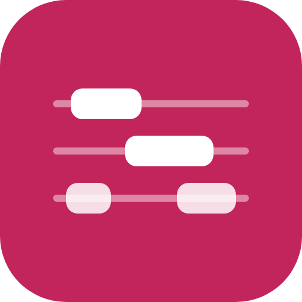
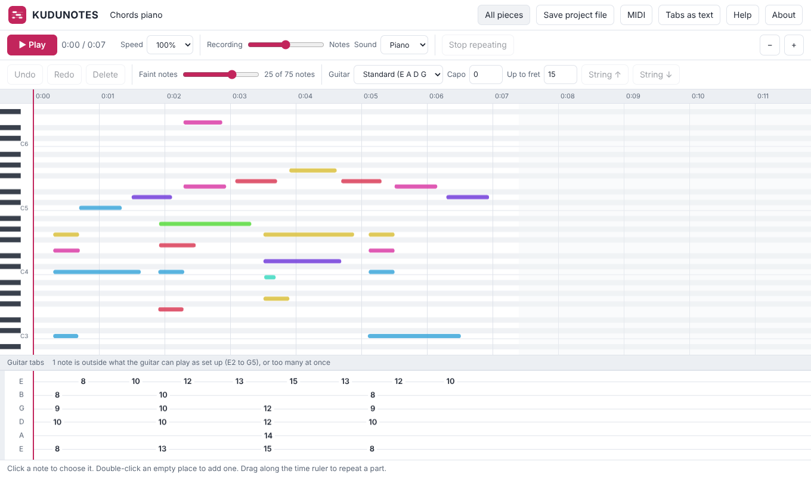
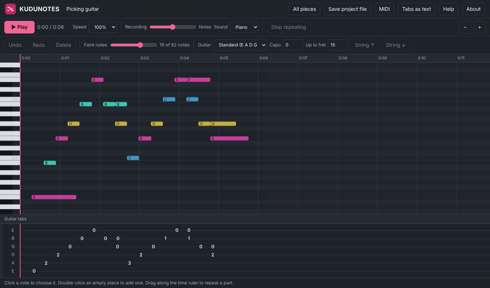

<p align="center">
  
</p>

<h1 align="center">KUDUNOTES</h1>

<p align="center">Listens to music and writes out its notes for piano and guitar: a piano roll and guitar tabs you can play back, slow down, correct and save. A free web app, and everything happens on your own device.</p>

<p align="center">
  
  <br><br>
  
</p>

---

## What it does

- **Listens to a recording**: open a sound file (MP3, WAV, M4A, or the sound of a video) or record with the
  microphone. It finds the notes, including several sounding at once.
- **Shows them two ways, in step**: a **piano roll** (a bar for each note beside a keyboard, coloured by note name)
  and **guitar tabs** (six strings with fret numbers) on the same time line.
- **Plays them back**: the notes in the app's own piano or guitar sound, the recording, or both mixed together,
  which is the quickest way to hear a wrong note. Slow it down without changing the pitch, repeat a part by dragging
  along the time ruler, click anywhere to jump.
- **Lets you put it right**: drag a note to move it, drag its end to make it longer or shorter, delete it, or
  double-click to add one. Undo and redo. A **Faint notes** slider hides the notes it wasn't sure it heard.
- **Guitar set-up**: standard tuning, Drop D, half a step down, open G and DADGAD; a capo; the highest fret to use.
  It chooses strings and frets that keep the hand in one place and every chord within reach, and you can move any
  note to another string.
- **Keeps your work**: pieces are saved in your browser by themselves. **Save project file** makes one file (notes,
  corrections and the recording) to open on another device. **MIDI** and **Tabs as text** are for other music
  programs and for sharing.
- **Private**: the listening happens in your browser. Your recordings and pieces are never sent anywhere, and the
  app works without the internet once it has been opened.

## What to expect

No program writes down music perfectly, and how well this one does depends on the recording:

- **One instrument alone** (a piano, a guitar): the notes come out well and usually need only small corrections.
- **Two instruments, or thick chords**: more extra and missing notes to put right.
- **Singing, drums or a whole band**: it gets confused. Use a recording of the instrument on its own.

It shows what was played and when. It doesn't write sheet music, and it doesn't tell two instruments apart: with
two playing, all the notes are shown together.

## How to use it

| | |
|---|---|
| Play or pause | **Space**, or the Play button |
| Jump to a moment | click the time ruler (or the tabs) |
| Repeat a part | drag along the time ruler; **Stop repeating** to end |
| Choose a note | click it; **Shift**+click or drag a box for several; **Ctrl+A** for all |
| Move a note | drag it, or the arrow keys (**Shift** for bigger steps) |
| Longer or shorter | drag the note's right end |
| Add a note | double-click an empty place |
| Remove | **Delete** |
| Undo, redo | **Ctrl+Z**, **Ctrl+Y** |
| Another guitar string | choose the note, then **String ↑ / String ↓** (or **]** and **[**) |
| Move through time, zoom | mouse wheel; **Ctrl**+wheel, or **+** and **−** |

It is made for a computer with a mouse. On a phone it opens, records, shows and plays pieces, but correcting notes
on a small touch screen is basic.

## Putting it on your own server

KUDUNOTES is only files: any web server can hand them out. Recording with the microphone needs an **https**
address. See [INSTALL.md](INSTALL.md) for step-by-step instructions (Caddy or nginx).

## Trying it on your own computer

You need [Node.js](https://nodejs.org) 22 or newer. There is nothing to build.

```
npm run serve          # then open http://localhost:8080/
npm test               # tidying, the guitar, MIDI, project files, editing, the files
npm run test:browser   # uses the real app in Chromium (needs Playwright); screenshots in screenshots/
```

## What it's made of

The listening is done by [Basic Pitch](https://github.com/spotify/basic-pitch-ts), made by Spotify's Audio
Intelligence Lab, running on [TensorFlow.js](https://github.com/tensorflow/tfjs) (both Apache License 2.0); they
are bundled into the app, so nothing is fetched from other sites. Everything else, including the piano and guitar
sounds, is the app's own code. See [THIRD-PARTY-NOTICES.txt](THIRD-PARTY-NOTICES.txt).

## Licence

MIT. Made by Azeem, with Claude and ♥. Part of the KUDU family of free apps.
